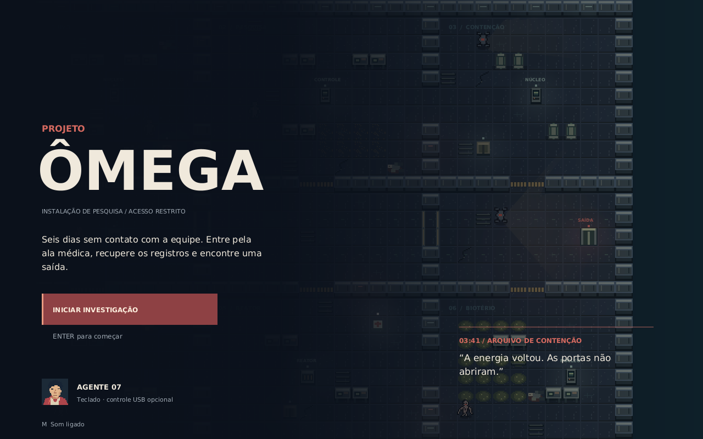
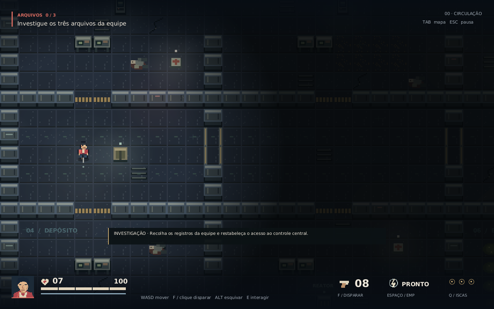

# Projeto Ômega

Jogo de investigação, exploração e furtividade em uma instalação científica abandonada. Você é o agente enviado para investigar o desaparecimento da equipe. A rede de segurança continua ativa, e organismos experimentais escaparam da contenção.

A história e os agentes seguem os PDFs da disciplina presentes na raiz. Veja a [relação entre requisitos e implementação](docs/IA_E_REQUISITOS.md).




## Jogar

Requer **JDK 17+** e ambiente gráfico. Java 21 também funciona.

```sh
./run.sh
```

Ou use a versão já compilada nesta máquina:

```sh
java -jar target/projeto-omega-1.0.0-play.jar
```

Com Maven instalado, inclusive no Windows:

```sh
mvn javafx:run
```

`./mvnw` instala Maven 3.9.9 quando necessário, verifica SHA-512 e baixa JavaFX na primeira compilação. Depois disso, o jogo funciona offline. O executável inclui as bibliotecas nativas da plataforma em que foi compilado; compile novamente no sistema de destino. A JVM não está embutida.

## Missão

Recupere os três arquivos da equipe, ligue o reator auxiliar, investigue o registro do incidente no **controle central** e saia pelo elevador. Segure E junto dos terminais. Acessar arquivos provoca panes e rupturas de contenção; ao chamar o elevador, é preciso sobreviver por 12 segundos e voltar à porta para embarcar. A planta da instalação destaca apenas o objetivo da etapa atual.

Os inimigos enxergam, ouvem e lembram pistas. Sentinelas e drones comunicam avistamentos próximos por rádio, com atraso e validade. Criaturas não recebem informações por rádio. Feche portas para cortar rotas, quebre contato visual ou use ruídos para distrair a segurança. Ataques têm uma preparação que permite esquivar; correr consome fôlego e denuncia a posição.

## Teclado e mouse

**O teclado funciona sempre, sem controle e sem configuração.**

| Entrada | Ação |
| --- | --- |
| WASD / setas | Mover |
| Shift | Correr |
| F / botão esquerdo do mouse | Disparar; o mouse aponta a arma |
| Alt / V | Esquiva; consome 24 de fôlego |
| Ctrl / C | Andar silenciosamente |
| E, segurar | Interagir |
| R | Abrir / fechar uma porta próxima |
| Q | Lançar uma isca sonora |
| Espaço | Pulso EMP, com recarga de 9 s |
| Tab | Mostrar / esconder a planta |
| Esc | Pausar / continuar |
| Enter | Iniciar / continuar / tentar novamente |
| M | Mute |
| G | Depurar IA: estados, pistas, intenções e rotas |
| F2 | Remapear os quatro botões do controle opcional |
| F11 | Tela cheia |
| PgUp / PgDn / roda do mouse, na pausa | Percorrer registros |

Os botões de menu respondem ao mouse. A pausa tem volumes independentes de ambiente e efeitos. Perder o foco pausa a simulação e limpa o estado das entradas.

## Controle USB opcional

No **Linux**, o jogo detecta controles expostos como `/dev/input/js*`, incluindo adaptadores USB de nintendinho. Não depende de internet nem exige o controle para iniciar. Não altera o teclado.

| Controle | Ação |
| --- | --- |
| Direcional / analógico | Mover |
| A, segurar | Interagir; com movimento, andar silenciosamente |
| A junto de uma porta | Abrir / fechar |
| B, toque curto | Pulso EMP ao soltar |
| A + B | Disparar |
| Select + A | Esquivar |
| B, segurar | Correr |
| Select, ao soltar | Isca sonora |
| Start | Pausar / continuar |
| Select + Start | Mostrar / esconder o mapa |
| Select, na pausa | Voltar ao menu |
| A, no menu ou no fim da missão | Iniciar / tentar novamente |

Se o adaptador usar outros números de botão, pressione **F2** e indique A, B, Select e Start nessa ordem. A configuração vale enquanto a janela estiver aberta. Controles com mais botões também podem usar os botões 4/5 para corrida/furtividade, quando não estiverem atribuídos a uma função principal.

A integração nativa implementada é a API de joystick Linux. No Windows/macOS, o teclado continua disponível e adaptadores que emulam teclado podem ser usados. Não havia controle físico conectado no ambiente de desenvolvimento; o decodificador e o remapeamento têm testes com eventos simulados.

## Ação e exploração

O agente começa com oito cartuchos. Drones resistem a dois acertos, sentinelas a três e criaturas a quatro. Disparos atraem atenção; atordoar, fechar portas e passar sem combater continua sendo possível. Arquivos e caixas de suprimentos recuperam munição, limitada a 14 cartuchos.

A esquiva custa fôlego, tem recarga de 1,05 s, protege brevemente contra dano e respeita as paredes. O ataque inimigo continua tendo uma preparação legível. Após restaurar a energia, falhas elétricas são anunciadas antes das descargas e alteram os custos de navegação dos agentes.

Rupturas liberam criaturas em pontos fora da visão e afastados do jogador, com uma preparação antes de entrarem em ação. O motor do elevador faz barulho e pode atrair ameaças durante a espera. As regras de visão, memória e rádio permanecem as dos PDFs.

## Visual e áudio

Personagens e tiles têm células **16×16 reais**, com escala inteira e sem suavização. Os personagens têm quatro direções e quatro quadros. Sentinelas têm silhueta humanoide, drones têm rotores e lentes de segurança, e criaturas têm braços alongados e anatomia exposta. O cenário usa cinza industrial, tons gastos, corrosão, manchas, rachaduras e iluminação de emergência.

O protagonista usa jaqueta vermelha, cabelo escuro e equipamento de campo, com vistas direcionais desenhadas em 16×16 e retrato de identificação próprio. A interface usa ícones de equipamento, munição e barras de vida/fôlego; o mapa continua opcional. Os efeitos incluem poeira, faíscas, vapor de portas, pulsos e partículas EMP, fragmentos de dados em terminais, sinais de rádio, preparação de ataques, impactos, vinheta de dano, luzes com falha e tremor breve de câmera.

O mixer de áudio usa **uma única saída estéreo 44,1 kHz**, permitindo efeitos simultâneos sem abrir uma linha por som. Há 23 sons originais: ambiente de 48 s, maquinaria, passos alternados, respiração, batimentos, rádio, alertas, criatura, portas, terminais, impactos, disparos, ricochetes, ruptura de contenção e pulso. A ameaça e o cansaço controlam camadas do som; alertas de inimigos têm posição estéreo e atenuação por distância.

Linux usa `pacat` com PulseAudio/PipeWire quando disponível e recorre a Java Sound nos demais casos. A pausa informa a saída ativa ou o erro encontrado. Eventos produzidos durante a carga inicial ficam na fila; mute atua no mixer inteiro. Volumes de ambiente e efeitos são independentes.

Todos os PNGs e WAVs já estão incluídos. Para recriá-los, opcionalmente:

```sh
python3 -m pip install Pillow numpy
python3 tools/generate_assets.py
```

## Compilar e verificar

```sh
./mvnw clean package
./mvnw test
./mvnw javafx:run -Djavafx.args=--smoke
```

O smoke gráfico abre a própria janela, salva menu, jogo, efeitos e mapa em `target/screenshots/` e fecha. Não captura outras janelas. Os testes de regras, áudio PCM e controle não precisam de dispositivo de áudio, joystick ou ambiente gráfico.

Verificações opcionais de integração, após `package`, em Linux/macOS:

```sh
java -cp target/test-classes:target/projeto-omega-1.0.0-play.jar org.example.UiSmoke
java -cp target/test-classes:target/projeto-omega-1.0.0-play.jar org.example.AudioSmoke
java -cp target/test-classes:target/projeto-omega-1.0.0-play.jar org.example.PlaythroughSmoke
```

`UiSmoke` abre a janela e testa movimento junto de disparos e outras ações, interação, pausa e mouse. `PlaythroughSmoke` percorre uma missão inteira por simulação, com agentes ativos, munição, dano e interações, sem teleporte ou alteração direta da vida. `AudioSmoke` toca ambiente e efeitos por cerca de dois segundos e verifica que o dispositivo recebe os quadros de áudio.

## Código

- `game/`: missão, portas, partículas e condições de fim.
- `entities/`: jogador e agentes, com estados de ciclo Enter/Update/Exit.
- `ai/`: A*, navegação dinâmica, memória de evidências e coordenação por rádio.
- `input/`: teclado independente e controle USB opcional.
- `render/`: câmera, sprites, interface e efeitos.
- `audio/`: mixer estéreo testável e saídas de reprodução.
- `tools/generate_assets.py`: fontes reproduzíveis da arte e do áudio.
- `src/test/`: regras, sistemas avançados e checagens opcionais.

As capturas e a documentação das atividades anteriores permanecem em `images/*atv*` e `docs/documentacao_atv_03_astar.pdf`.
